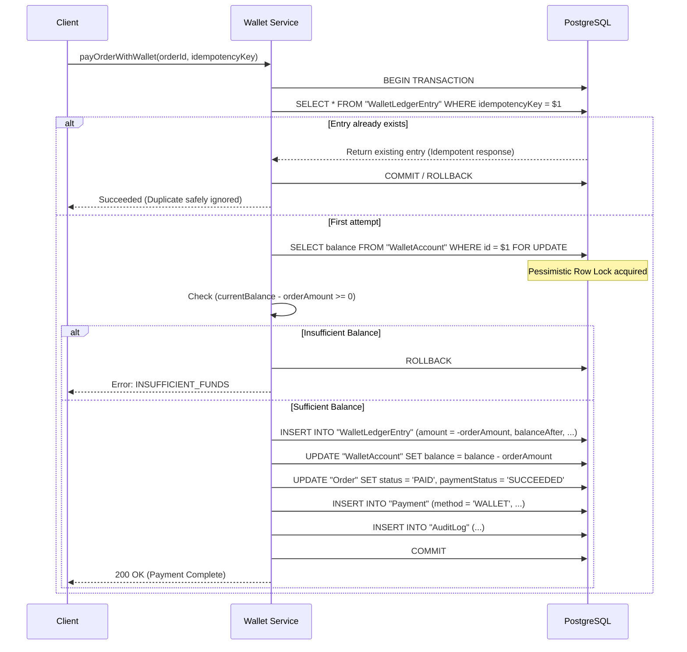

# Customer Wallet & Auditable Ledger Documentation

## 1. Overview and Core Invariants

The Customer Wallet subsystem is engineered following strict double-entry and auditable journal principles for the Malaysia → Bangladesh Pre-Order Platform.

### Invariants:
1. **Ledger as Source of Truth**:
   The wallet balance is an append-only ledger journal. The cached balance column on `WalletAccount` is maintained in the exact same database transaction as each ledger entry and is continuously verifiable against `SUM(amount)` of all immutable ledger entries.
2. **PostgreSQL Check Constraint**:
   A database-level constraint `wallet_balance_non_negative` (`CHECK (balance >= 0)`) prevents any transaction from producing a negative balance or allowing overdraft / double-spending.
3. **No Direct Balance Manipulation**:
   There is **no** balance edit endpoint, mutation query, or admin input field. Balances can change *only* through:
   - Verified payment confirmation (`TOP_UP`)
   - Pre-order checkout debit (`ORDER_PAYMENT`)
   - Compensating refund credit (`ORDER_REFUND`)
   - Explicit auditable system adjustment entries (`ADJUSTMENT_CREDIT` / `ADJUSTMENT_DEBIT`)
4. **Append-Only History**:
   Ledger entries are strictly immutable. Deletions and edits of historical ledger rows are completely forbidden. Compensations are performed by appending new ledger entries with explicit reference notes.
5. **Integer Minor Units**:
   Money arithmetic is executed in integer minor units (poisha for BDT: 1 BDT = 100 poisha). Decimal formatting is applied exclusively at the presentation boundary.
6. **Strict Idempotency**:
   Every ledger entry mandates a globally unique `idempotencyKey`. Duplicate attempts return the existing entry without creating duplicate records or modifying balances.
7. **No Cash-Out/Withdrawals**:
   In compliance with cross-border trade and anti-money laundering regulations, customer cash withdrawals are strictly disabled. Available wallet funds may only be spent towards accepted pre-orders.

---

## 2. Data Model

### Entity: `WalletAccount`
Represents a customer's registered wallet.

| Column | Type | Description |
|---|---|---|
| `id` | `UUID` (Primary Key) | Unique identifier |
| `userId` | `UUID` (Unique, FK) | References customer user |
| `currency` | `TEXT` | Default: `BDT` |
| `balance` | `DECIMAL(12, 2)` | Transactionally cached aggregate balance (CHECK >= 0) |
| `isActive` | `BOOLEAN` | Whether wallet is active |
| `createdAt` | `TIMESTAMP` | Account creation timestamp |
| `updatedAt` | `TIMESTAMP` | Last updated timestamp |

### Entity: `WalletLedgerEntry`
Represents an individual immutable entry in the audit journal.

| Column | Type | Description |
|---|---|---|
| `id` | `UUID` (Primary Key) | Unique identifier |
| `walletId` | `UUID` (FK) | Reference to `WalletAccount` |
| `entryType` | `WalletLedgerEntryType` | Enum: `TOP_UP`, `ORDER_PAYMENT`, `ORDER_REFUND`, `ADJUSTMENT_CREDIT`, `ADJUSTMENT_DEBIT`, `REVERSAL` |
| `amount` | `DECIMAL(12, 2)` | Positive for credits, negative for debits |
| `balanceAfter` | `DECIMAL(12, 2)` | Exact balance snapshot immediately after entry was posted |
| `currency` | `TEXT` | Default: `BDT` |
| `idempotencyKey` | `TEXT` (Unique) | Unique key preventing double actions |
| `referenceNote` | `TEXT` | Human-readable audit narrative |
| `paymentId` | `UUID` (Nullable, FK) | Reference to `Payment` if top-up or checkout |
| `orderId` | `UUID` (Nullable, FK) | Reference to `Order` |
| `refundId` | `UUID` (Nullable, Unique, FK) | Reference to `Refund` if compensating entry |
| `createdById` | `UUID` (Nullable) | Actor who triggered the entry |
| `createdAt` | `TIMESTAMP` | Immutable creation timestamp |

---

## 3. Concurrency Safety & Anti Double-Spending Architecture

When a debit is requested (e.g. paying for an order):


### Key Technical Safeguards:
- **`SELECT ... FOR UPDATE`**: Eliminates race conditions between simultaneous checkout requests across multiple browser tabs or worker processes.
- **PostgreSQL `CHECK ("balance" >= 0)` constraint**: Guarantees at the database engine level that balance can never become negative under any concurrent execution.

---

## 4. Top-Up & Verification Workflow

1. Customer chooses an amount and initiates top-up via `/api/wallet/topup/initiate`.
2. An internal `ORD-TOPUP-XXXX` record is created with payment status `PENDING`.
3. Customer completes checkout via configured payment gateway (bKash, Nagad, SSLCommerz, Card).
4. **Funds are NOT spendable yet** and appear clearly in the customer's portal under **"Pending Top-Ups (Awaiting Provider Verification)"**.
5. Upon receipt and cryptographic signature verification of the official provider webhook in `lib/payments/service.ts`, `creditWalletFromVerifiedPayment()` is executed atomically within the transaction.
6. The customer's available balance is credited and an immutable `TOP_UP` ledger entry is posted.

---

## 5. Order Debits & Compensating Refunds

### Order Checkout via Wallet:
- Customer calls `/api/wallet/pay-order` with `orderId` and a client-generated `idempotencyKey`.
- Wallet balance is locked and checked.
- If sufficient, a negative debit entry is recorded, cached balance is decremented, order transitions to `PAID`, and a payment record with method `WALLET` is stored.

### Cancellations and Refunds:
- Refunds never edit or delete previous ledger records.
- In `refundOrderToWallet()`, a compensating entry (`ORDER_REFUND`, positive amount) is appended, referencing the `Refund` record's unique ID.
- The balance is restored, the `Refund` record is marked `COMPLETED`, and the order event log is updated.

---

## 6. Financial Reconciliation Procedure

### Purpose
Ensures that the cached aggregate balance on `WalletAccount` is 100% consistent with the sum of all immutable ledger entries in `WalletLedgerEntry`.

### Verification Logic:
$$\text{Discrepancy} = \text{CachedBalance} - \sum \text{LedgerEntries.amount}$$

### Reconciliation Steps:
1. **Automated Audit**:
   - Access Admin Portal: `/admin/wallet`.
   - Every wallet account displays its `Cached Balance`, `Computed Ledger Sum`, and `Integrity Status` (`Balanced` vs `Discrepancy`).
2. **On-Demand Single Wallet Audit**:
   - Call `POST /api/wallet/reconcile` with `{ "walletId": "..." }`.
   - System executes `reconcileWallet(walletId)` and returns:
     ```json
     {
       "walletId": "...",
       "cachedBalanceBDT": "1000.00",
       "computedLedgerSumBDT": "1000.00",
       "isConsistent": true,
       "discrepancyMinorUnits": 0,
       "discrepancyBDT": "0.00",
       "checkedAt": "2026-10-22T22:30:00.000Z"
     }
     ```
3. **Discrepancy Handling Protocol**:
   - If `discrepancyMinorUnits !== 0`:
     - Finance staff views the full ledger audit log for that wallet account.
     - Review associated payment gateway records, orders, and database migration logs.
     - System does NOT permit arbitrary balance overwrites. Any correction must be documented and appended as an audited `ADJUSTMENT_CREDIT` or `ADJUSTMENT_DEBIT` entry with clear supervisor justification and audit metadata.
